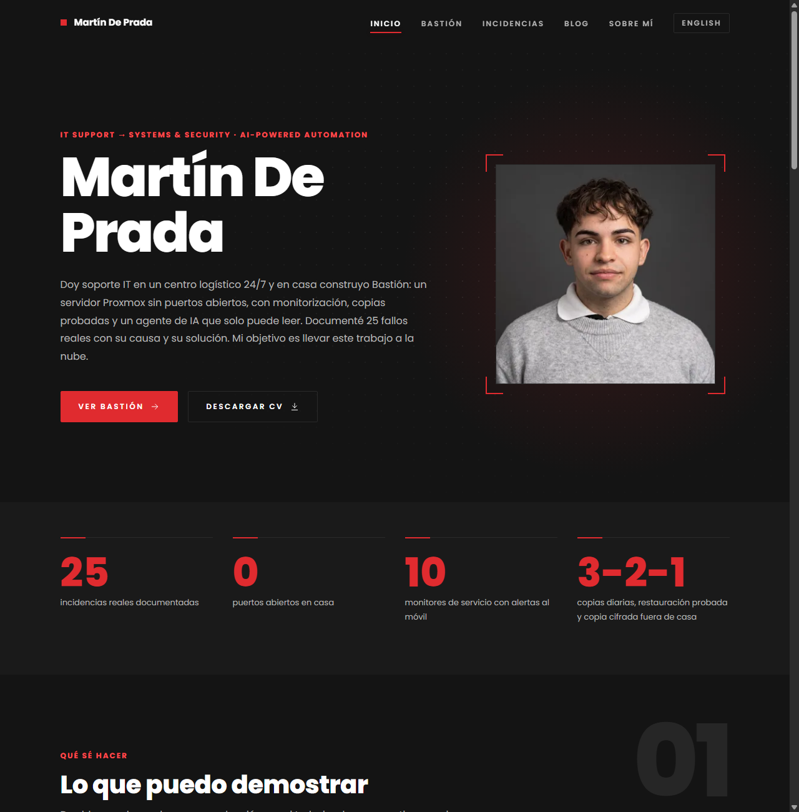
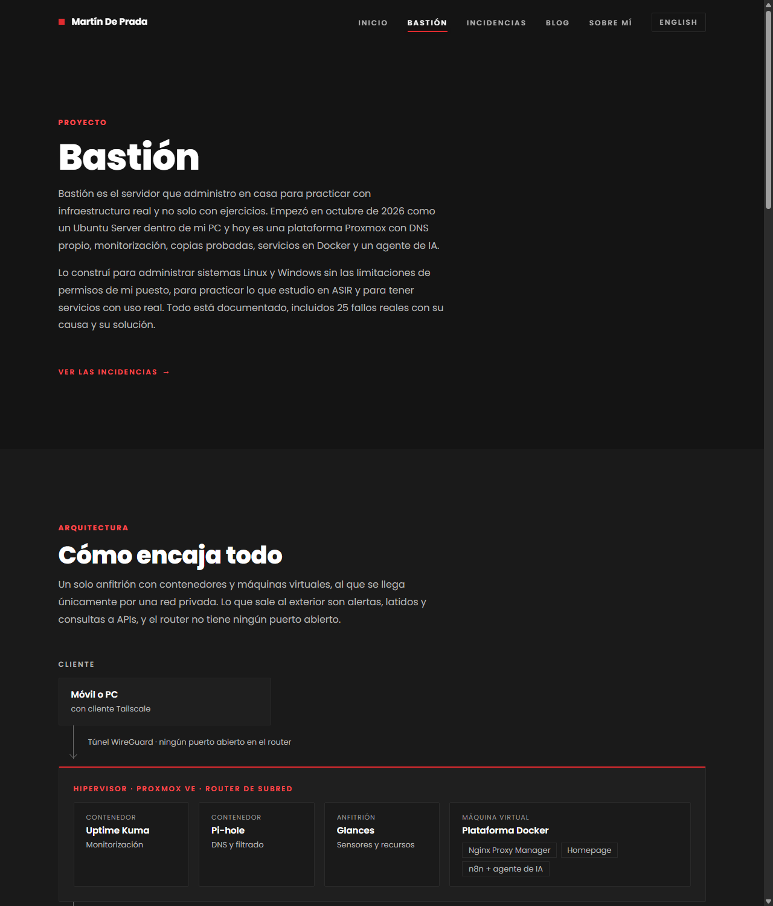
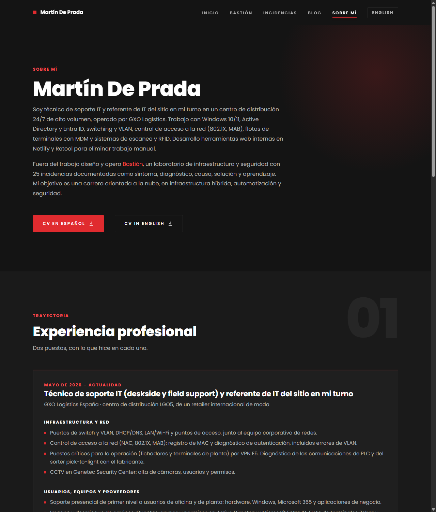
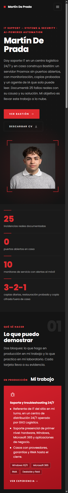

# bastion-web

Portafolio de Martín De Prada y bitácora de **Bastión**, su laboratorio de infraestructura y seguridad autoalojado. Está pensado para que quien lo lea entienda en 30 segundos qué sabe hacer y pueda comprobarlo.

**Web:** <https://martindeprada.dev>

| Inicio | Bastión |
| --- | --- |
|  |  |

| Sobre mí | Móvil (360 px) |
| --- | --- |
|  |  |

## Qué contiene

- **Inicio:** lo que puedo demostrar (mi trabajo y mi laboratorio), método de troubleshooting y experiencia.
- **Sobre mí:** experiencia, formación, tecnologías por área, idiomas y CV en español e inglés.
- **Blog:** sección provisional.
- **Bastión** (área propia, se abre en una pestaña nueva, con subpestañas): Funcionamiento (`/bastion/`), Conexiones, Estado, Incidencias y Hoja de ruta. Estado e Incidencias son esqueletos por ahora.
- **Inglés (`/en/`)** y **`/estilo`** (guía de estilo, sin enlace en el menú).
- La ruta antigua `/incidencias/` redirige a `/bastion/incidencias/`.

## Stack

- [Astro](https://astro.build) 7, sitio estático (`output: 'static'`).
- TypeScript estricto y `astro check` en cada compilación.
- CSS propio con variables, sin frameworks. Tipografía Poppins con `@fontsource/poppins` (sin peticiones a terceros).
- Sin analítica, sin cookies y sin recursos externos. JavaScript mínimo: solo el menú móvil.
- Efectos de movimiento solo con CSS (`animation-timeline`, `@property`), con alternativa sin animación y respeto de `prefers-reduced-motion`.

## Estructura

```
src/
  assets/       imágenes procesadas por Astro (foto)
  components/   Card, Stat, Terminal, Timeline, ArchDiagram, Nav, Footer…
  data/         roadmap.ts (hoja de ruta), bastion.ts (capas y decisiones), experience.ts (experiencia)
  i18n/         textos de la interfaz en español e inglés
  layouts/      BaseLayout.astro y BastionLayout.astro (área Bastión)
  lib/          url.ts (rutas y datos públicos del autor)
  pages/        una página por ruta; bastion/ es el área Bastión; en/ contiene la versión en inglés
  styles/       global.css (variables y utilidades)
public/
  cv/           CV en PDF (español e inglés)
docs/img/       capturas del README
```

## Desarrollo

```
npm install
npm run dev      # http://localhost:4321/
npm run build    # comprueba tipos y genera dist/
npm run preview  # sirve dist/
```

## Actualizar la hoja de ruta

Está en `src/data/roadmap.ts`. Para cambiar el estado de un elemento, edita su `status` (`'done'`, `'doing'` o `'todo'`). Para añadir una fase, agrega un objeto a `phases` en el orden en que debe aparecer. Después actualiza la constante `UPDATED` con la fecha. La página de Bastión lo muestra sola, con el recuento de elementos hechos por fase.

## Añadir una incidencia o un artículo

Las incidencias llegan en la fase 3 y el blog en la fase 4, ambos como colecciones de contenido de Astro con esquema validado. Esta sección se completará con el procedimiento exacto cuando existan.

## Cambiar de alojamiento o de dominio

Se edita **una sola variable**, `SITE_URL`, en `astro.config.mjs`:

```js
const SITE_URL = 'https://tudominio.com';
```

`site` y `base` se calculan a partir de ella. La carpeta `dist/` se puede copiar tal cual a cualquier servidor estático.

## Despliegue

Cada push a `main` lanza un flujo de GitHub Actions que compila el sitio y lo publica en GitHub Pages, con dominio propio. Si el flujo falla, el sitio publicado no cambia.

## Reglas de privacidad

El repositorio es público, así que el contenido sigue estas reglas:

- No se publican direcciones IP, nombres de host internos, dominios de la red local, el nombre de la red privada, temas ni URL de notificaciones, tokens ni usuarios de sistema.
- No se publican teléfono, dirección ni localidad exacta; solo «Madrid, España».
- Los datos de contacto autorizados están en `src/lib/url.ts`.
- El material de trabajo (`fuentes/`) está en `.gitignore` y no se sube.
- Los CV de `public/cv/` son la fuente de verdad de la experiencia y no se editan sin avisar.
- Antes de publicar se revisa el contenido con una búsqueda de patrones sensibles.
